cd ~/Desktop/devops-internship

cat > projects/aws-production-infrastructure/README.md <<'EOF'
# AWS Production Infrastructure

**A multi-AZ AWS infrastructure deployment for a Node.js e-commerce application.**

This project demonstrates how to design a segmented AWS network, run application servers in private subnets, restrict traffic with security groups, and expose an application through an internet-facing Application Load Balancer.

<p align="center">
  
  
  
  
  
</p>

---

## Table of Contents

- [Project Overview](#project-overview)
- [Architecture](#architecture)
- [AWS Infrastructure](#aws-infrastructure)
- [Network and Security Design](#network-and-security-design)
- [Application Traffic Flow](#application-traffic-flow)
- [Implementation Evidence](#implementation-evidence)
- [Validation and Testing](#validation-and-testing)
- [Technologies Used](#technologies-used)
- [Challenges and Lessons Learned](#challenges-and-lessons-learned)
- [Future Improvements](#future-improvements)
- [Project Scope](#project-scope)

## Project Overview

The goal of this project is to deploy an e-commerce web application on AWS using a production-style network design.

Instead of exposing application servers directly to the internet, the application runs on private EC2 instances. An Application Load Balancer acts as the public entry point and forwards incoming HTTP requests to healthy application targets.

The infrastructure is deployed in the **Asia Pacific (Mumbai) region (`ap-south-1`)** across two Availability Zones.

### Key Objectives

- Design a custom VPC with public and private network segments.
- Deploy application instances in private subnets across two Availability Zones.
- Provide outbound connectivity for private resources through NAT Gateways.
- Apply least-exposure principles using security groups.
- Manage instances through AWS Systems Manager Session Manager instead of direct SSH.
- Distribute incoming HTTP traffic through an Application Load Balancer.
- Validate application availability and database connectivity using health checks.

## Architecture

### High-Level Design

```text
                        Internet Users
                              |
                              | HTTP :80
                              v
                 +---------------------------+
                 |   Application Load        |
                 |   Balancer (PROD-ALB)      |
                 |   Public Subnets           |
                 +-------------+-------------+
                               |
                      Target Group: ALB-tg
                         HTTP :3000
                         /         \
                        v           v
             +----------------+  +----------------+
             | Private EC2    |  | Private EC2    |
             | prod-1a        |  | prod-1b        |
             | AZ: ap-south-1a|  | AZ: ap-south-1b|
             +-------+--------+  +--------+-------+
                     |                    |
                     +---------+----------+
                               |
                         PostgreSQL
                    (application DB connection)
```

The diagram illustrates the main request path. The exact database placement and connectivity depend on the database configuration used by the application.

### Architecture Screenshot

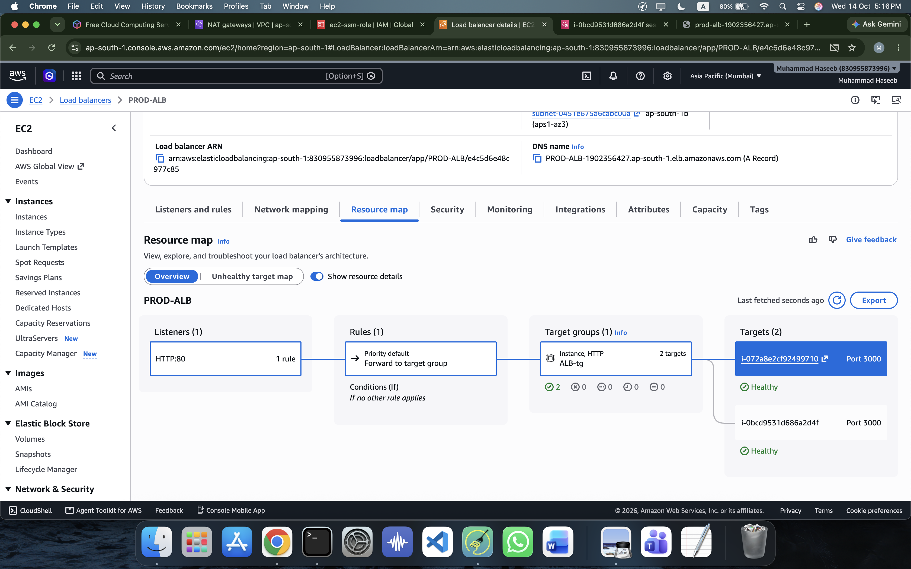

## AWS Infrastructure

| Component | Configuration |
|---|---|
| AWS Region | Asia Pacific (Mumbai), `ap-south-1` |
| VPC | `10.0.0.0/20` |
| Availability Zones | `ap-south-1a`, `ap-south-1b` |
| Public subnets | 2 |
| Private subnets | 4 |
| NAT Gateways | 1 per Availability Zone |
| Application instances | 2 private EC2 instances |
| Instance type | `t3.micro` |
| Application port | TCP `3000` |
| Load balancer | `PROD-ALB` |
| Target group | `ALB-tg` |
| Listener | HTTP `80` |
| Health check path | `/health` |

## Network and Security Design

### 1. Virtual Private Cloud

A dedicated production VPC provides an isolated network for the application infrastructure. Public and private subnets separate internet-facing components from application compute resources.

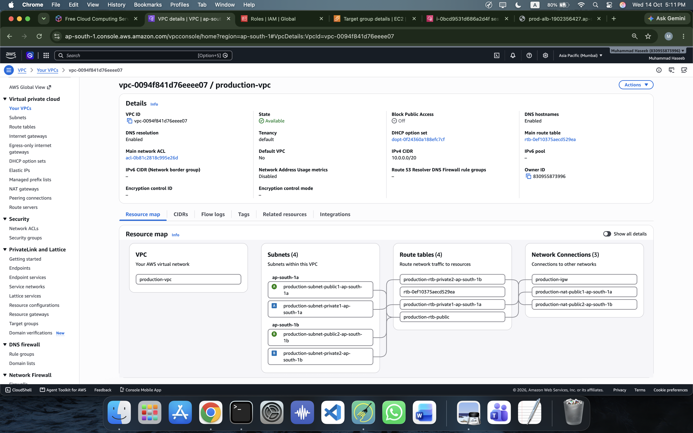

### 2. Subnets and Availability Zones

The network spans two Availability Zones to support application availability across separate zones. Public subnets host the internet-facing load balancer, while private subnets contain application resources.

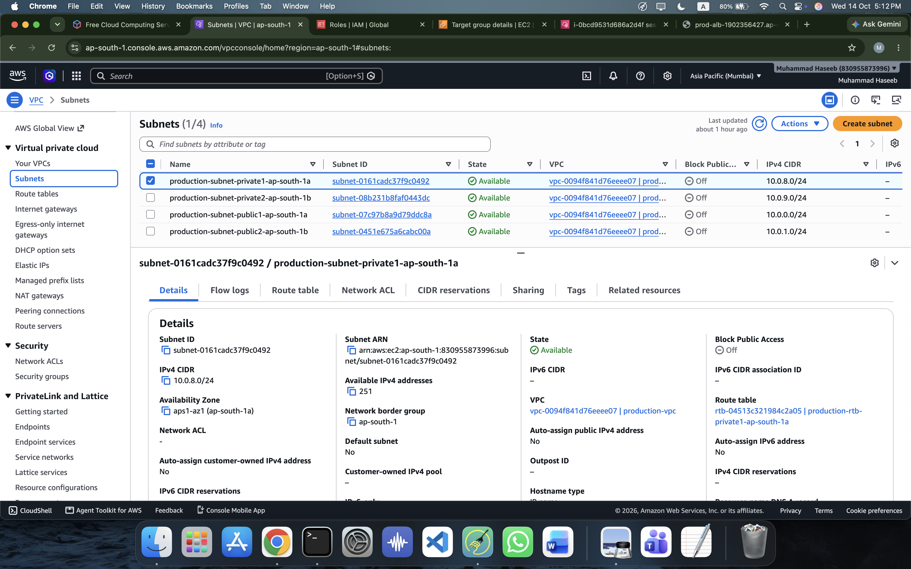

### 3. NAT Gateways

NAT Gateways provide outbound internet connectivity to resources in private subnets without requiring those application instances to have public IP addresses.

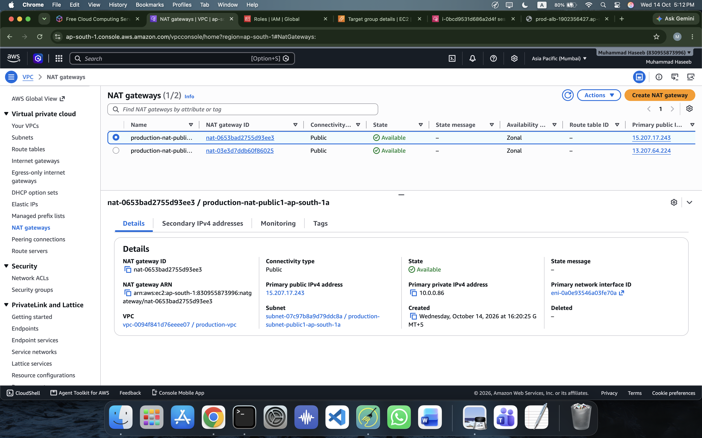

### 4. IAM and Systems Manager

The `ec2-ssm-role` instance role is configured for Systems Manager access using `AmazonSSMManagedInstanceCore`. Session Manager provides administrative access without requiring an inbound SSH rule.

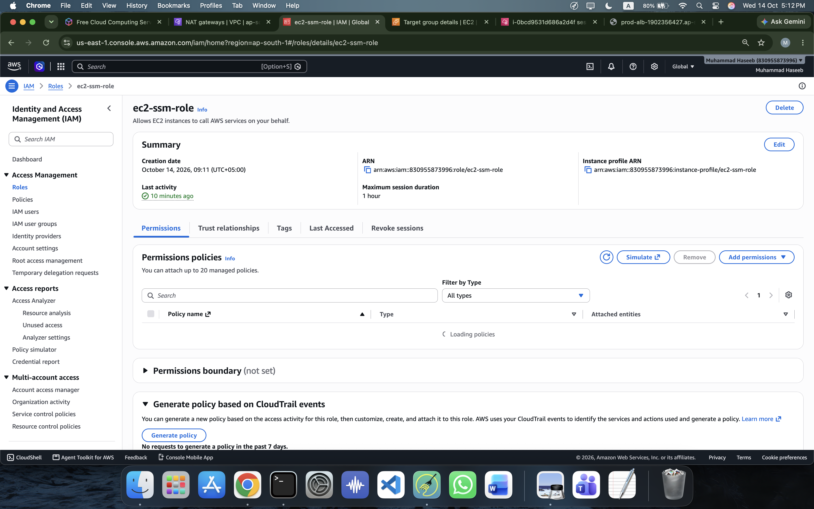

### 5. Security Groups

Two security groups separate public entry-point access from application access.

| Security group | Intended inbound access |
|---|---|
| `alb-sg` | HTTP, TCP port `80`, from `0.0.0.0/0` |
| `app-sg` | TCP port `3000`, sourced from `alb-sg` |

This design allows users to reach the ALB while restricting direct access to the application port on the EC2 instances.

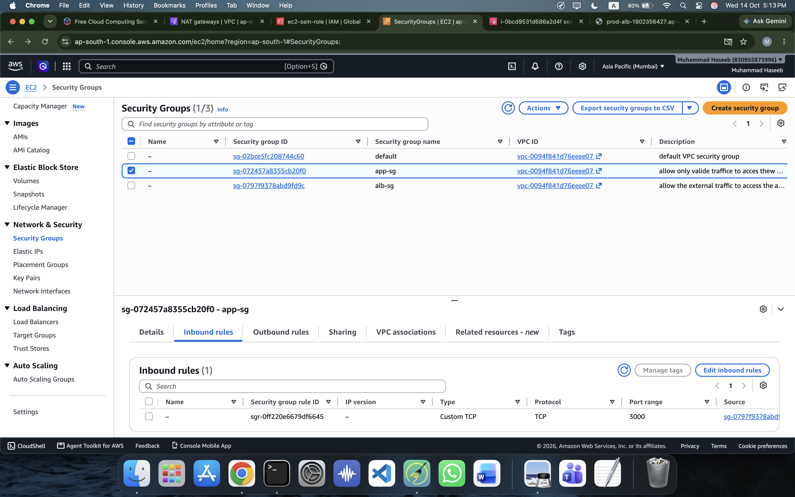

### 6. Private EC2 Instances

Two application instances, `prod-1a` and `prod-1b`, run in private subnets across the two Availability Zones. They use the application security group and are administered through Systems Manager.

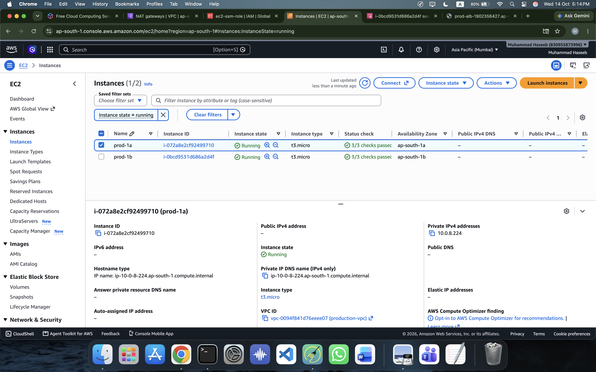

## Application Traffic Flow

The request path is designed as follows:

1. A user sends an HTTP request to the public DNS name of `PROD-ALB`.
2. The ALB listener on port `80` evaluates the request and forwards it to `ALB-tg`.
3. The target group sends traffic to a healthy EC2 application instance on port `3000`.
4. The Node.js application processes the request and interacts with its configured database.
5. The `/health` endpoint provides a way to check application health and database connectivity.

### Target Group Health

The `ALB-tg` target group uses the instance target type, HTTP on port `3000`, and the `/health` health-check path.

During validation, the target group reported **2 healthy targets and 0 unhealthy targets**.

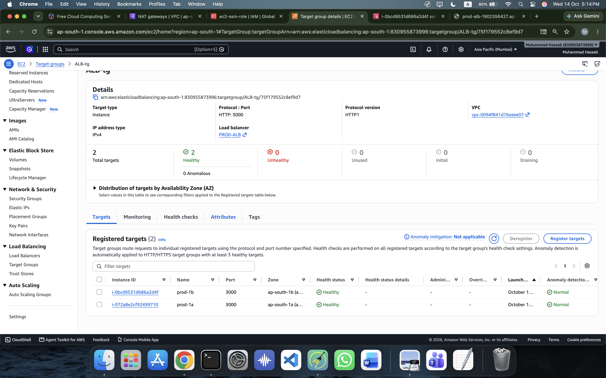

### Application Load Balancer

`PROD-ALB` is configured as an internet-facing Application Load Balancer using the production VPC and public subnets in both Availability Zones.

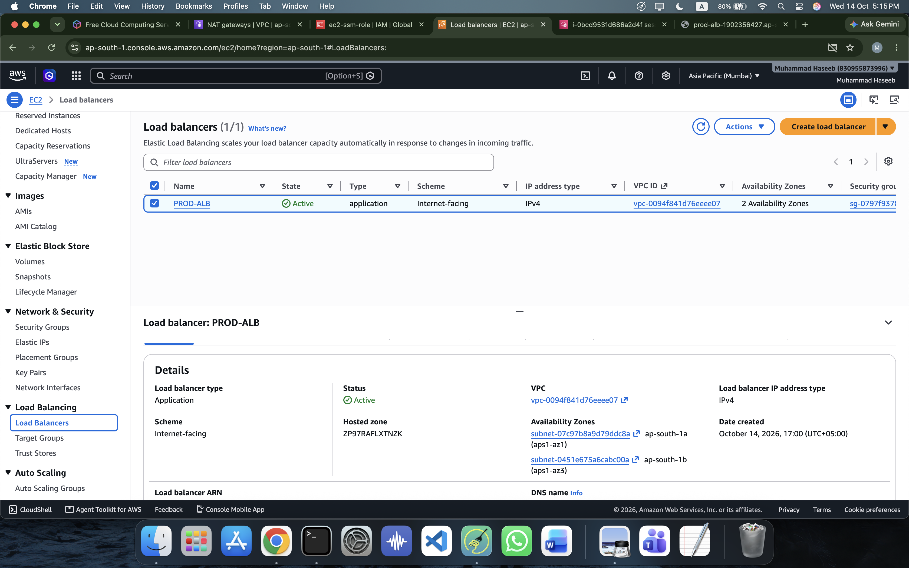

### Listener Configuration

The HTTP listener on port `80` forwards incoming requests to `ALB-tg`, which routes them to the application instances on port `3000`.

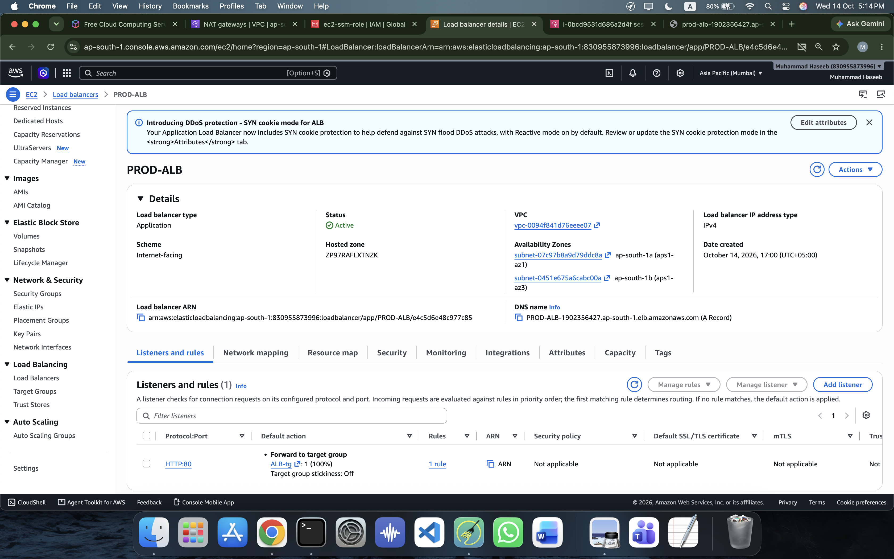

## Validation and Testing

### Health Endpoint

The application health endpoint was tested through the load balancer to verify that requests could reach the application and that the database connection was reported as connected.

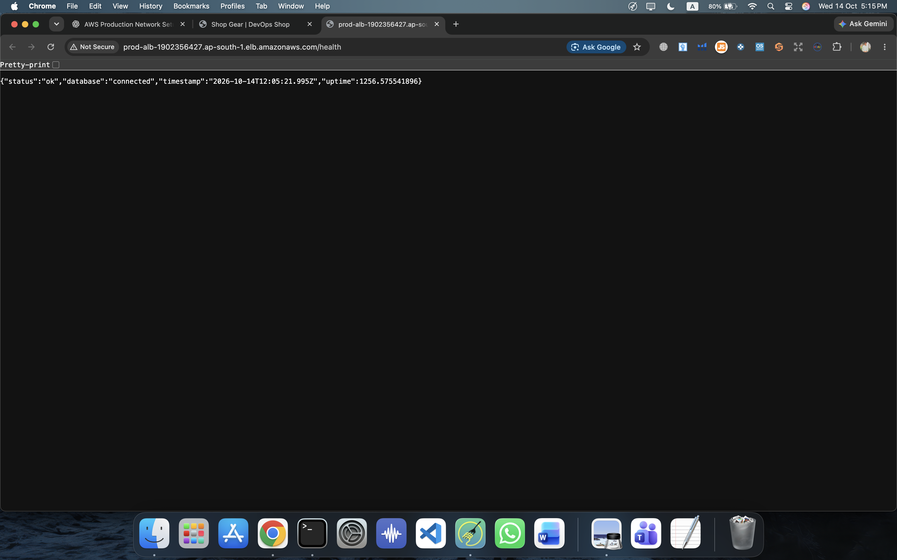

Expected response fields include:

```json
{
  "status": "ok",
  "database": "connected"
}
```

The response may include additional fields, such as a timestamp and uptime.

### Production Homepage

The e-commerce homepage was tested through the ALB DNS name rather than by accessing an application instance directly.

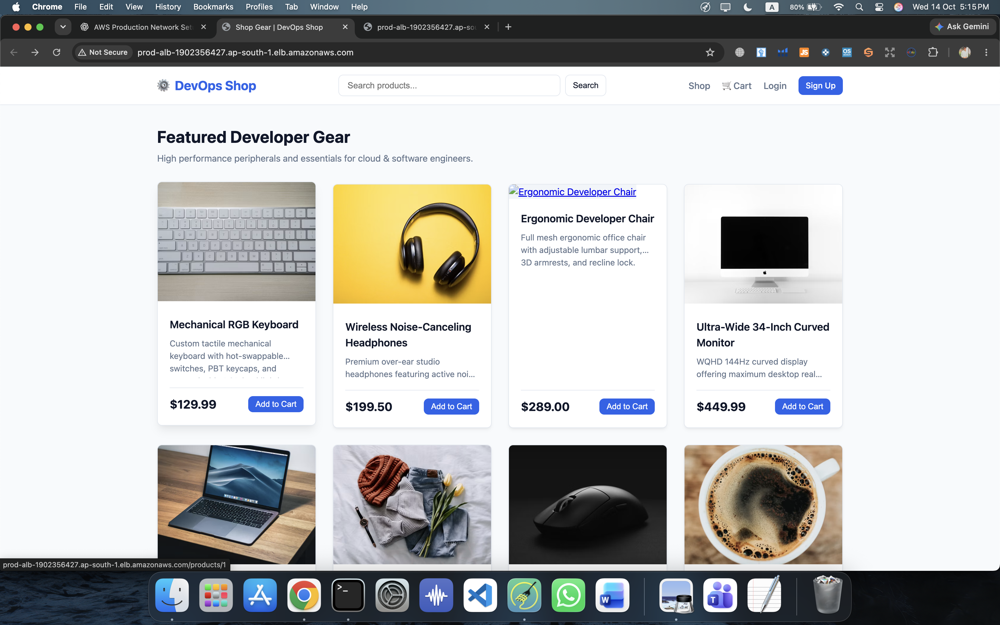

### Validation Summary

| Test | Result |
|---|---|
| VPC and subnet configuration | Implemented |
| Two private application instances | Deployed |
| ALB listener on HTTP port 80 | Configured |
| Target group on HTTP port 3000 | Configured |
| Target health checks | 2 healthy targets observed |
| Database connectivity | Health endpoint reported connected |
| Homepage through ALB | Tested |

## Technologies Used

- **Amazon VPC:** Network isolation and subnet design
- **Amazon EC2:** Application compute
- **Application Load Balancer:** HTTP traffic distribution
- **NAT Gateway:** Outbound connectivity from private subnets
- **AWS IAM:** Instance permissions
- **AWS Systems Manager:** Instance administration
- **Security Groups:** Network traffic restrictions
- **Node.js:** Web application runtime
- **PostgreSQL:** Application database

## Challenges and Lessons Learned

This project provided practical experience with:

- Separating public and private infrastructure.
- Understanding how ALB listeners, target groups, and health checks work together.
- Restricting application access to traffic from the load balancer.
- Managing instances without exposing SSH to the internet.
- Diagnosing application health and database connectivity.
- Verifying deployment behavior through AWS Console evidence.

## Future Improvements

Potential next steps to improve the infrastructure include:

- **Infrastructure as Code:** Provision and manage the environment using Terraform.
- **CI/CD:** Automate application testing and deployments through a pipeline.
- **HTTPS:** Add a domain, AWS Certificate Manager certificate, and HTTPS listener.
- **Monitoring:** Configure CloudWatch dashboards, logs, and alarms.
- **Database architecture:** Evaluate managed database deployment using Amazon RDS, including backups and private connectivity.
- **Disaster recovery:** Document recovery objectives, backups, and a tested recovery procedure.
- **Cost optimization:** Review NAT Gateway, load balancer, compute, and storage costs.

These are planned improvements, not claims that the features are already implemented.

## Project Scope

This project demonstrates a production-style AWS deployment with multi-AZ networking, private application instances, security-group restrictions, and load balancing.

It is a learning and portfolio project. A complete production environment would require further work on deployment automation, HTTPS, centralized observability, database resilience, recovery testing, and operational controls.

---

**Built as a hands-on Cloud and DevOps infrastructure project using AWS.**
EOF
